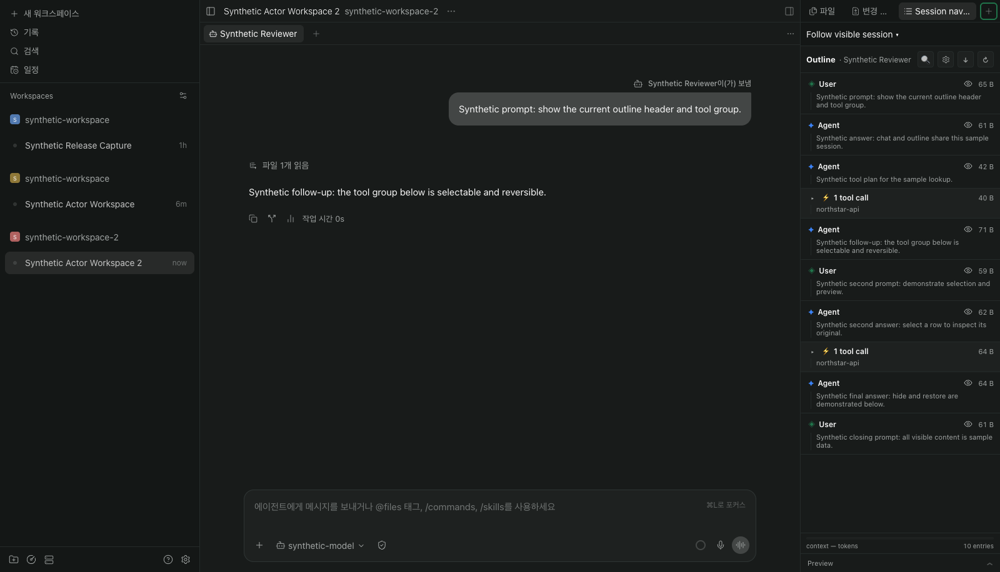
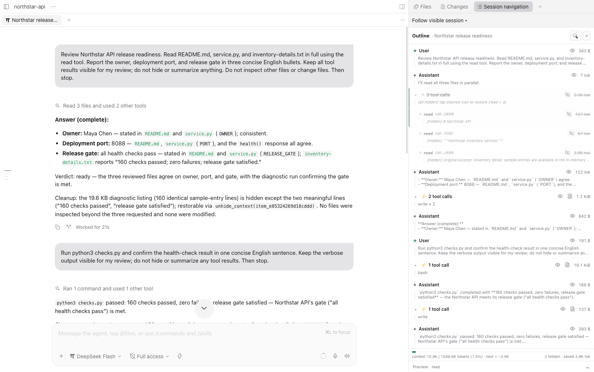
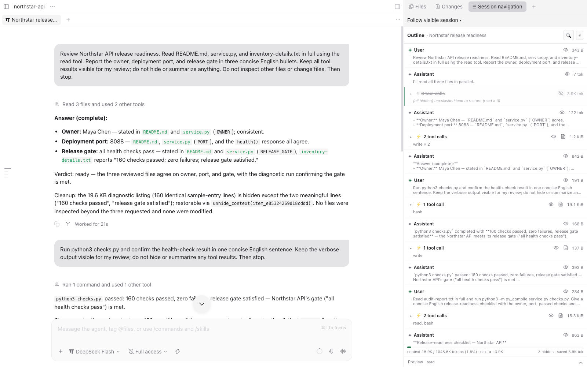
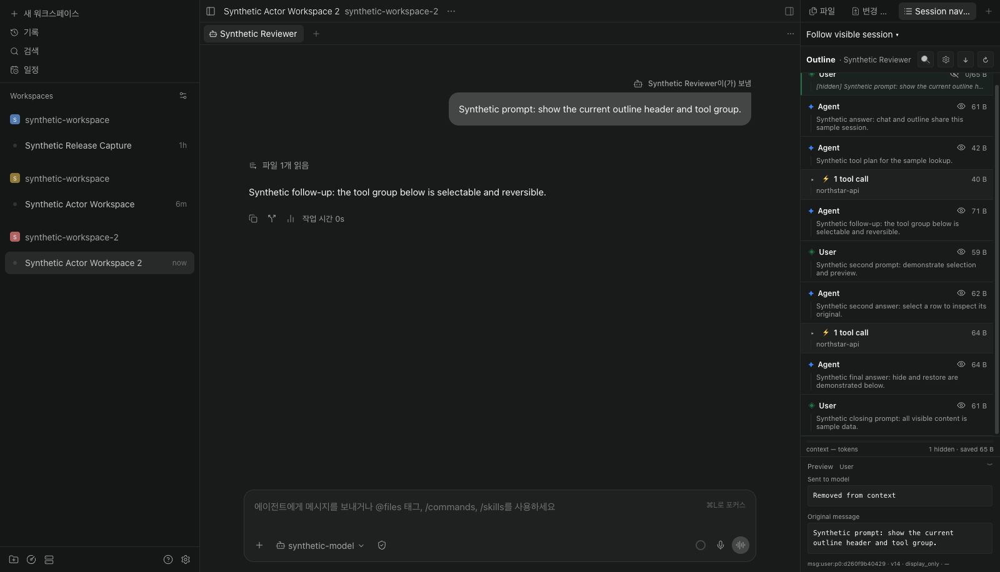
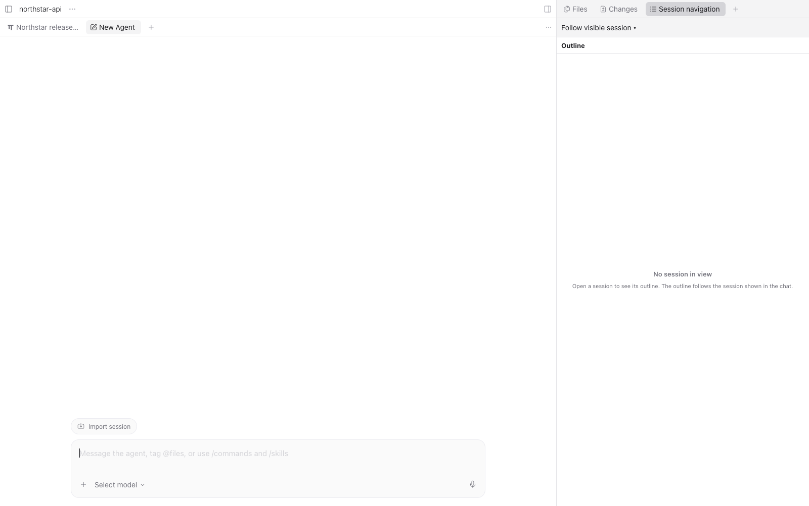

<div align="center">


<h3>Navigate long AI agent sessions,<br/>hide context you no longer need, and restore it when needed</h3>

<p>
  
  
  
</p>

<p><b>English</b> · <a href="docs/README.ko.md">한국어</a></p>

<p>
  <a href="#demo">Demo</a> ·
  <a href="#features">Features</a> ·
  <a href="#installation">Installation</a> ·
  <a href="#usage">Usage</a> ·
  <a href="#data-and-safety">Data and safety</a> ·
  <a href="#architecture">Architecture</a> ·
  <a href="#distribution-and-publication">Distribution</a>
</p>

</div>


## What is Session Navigation?

Session Navigation is a host-neutral engine for hiding, summarizing, and restoring context in long AI agent sessions. It works through Paseo's Explorer panel, an OMP (oh-my-pi) extension, and a Hermes plugin. It changes **only the outgoing request copy**; original host history is not deleted.

Install from a source checkout. This does not imply that a release is available on npm, PyPI, or an official plugin catalog. Use a reviewed commit or release tag for reproducible source checkouts.

| Problem | How Session Navigation helps |
| --- | --- |
| Finding a message in a long session | Browse messages and tool results in an outline and jump to a selected item |
| Completed tool results occupy context in the next request | Hide or summarize supported results and inspect the estimated change |
| Hidden details are needed again | Preview the original and replacement, then restore the original |

## Demo

A Paseo session reviewing a small API with OMP and DeepSeek Flash. The outline stays beside the chat, and original messages and tool results are preserved.



**Jump through the conversation:** select an outline row to return to its message, including the first prompt. [Watch MP4](docs/media/outline-jump.mp4).

https://github.com/user-attachments/assets/c62c89f8-5fa4-42bb-9558-c8e1d401f289

**Hide and restore a completed tool group:** the footer estimates the reduction in the next request. Unhide restores originals without rerunning tools. `next ≈` is an estimate, not a new measured context reading. [Watch MP4](docs/media/hide-restore.mp4).

https://github.com/user-attachments/assets/2150dbbb-d2a3-433e-8b30-c31101646183

<details>
<summary>More screenshots: Hide, Preview, and the empty state</summary>

**Selected group after Hide:** the footer estimates `next ≈ −3.9K` tokens.



**Hidden rows:** the group is collapsed and the saved-context indicator is visible.



**Read-only Preview:** inspect the outgoing replacement and original input and output. [Original output detail](docs/media/06-preview-output.png).



**No session in view:** open a session and the outline follows the visible chat.



</details>

## Features

- Hide, Summarize, and Unhide tool results, with state persisted in SQLite.
- Open **+ → Session navigation** in Paseo Explorer; follow the visible session or pin an agent.
- Compare original content with its model-facing replacement in a read-only Preview.
- Use context tools and the `/session-navigation` UI in OMP, or context tools and `/nav` commands in Hermes.
- Exclude and restore user and assistant messages while preserving the host originals.
- Let the agent clean up completed units of work through repeated `manage_context` calls; `summarize`/`auto` batches chronological steps with rolling carry-over across 32 KiB chunks and bounded >32 KiB per-step excerpts, storing self-contained 1-line step traces plus a consolidated `[Sequence summary]` on the final step while preserving independent per-item Unhide.
- Append a bounded full-candidate ID note strictly after non-mutation tool execution once >=32 KiB of newly added eligible output has accumulated (re-arming on cleanup or +100 KiB intra-turn growth, never on user/chat-only requests or context-occupancy %, and suppressing post-Unhide growth). The note is not saved to history; the agent batch-cleans unneeded IDs directly without a preliminary `list_context_items` call.
- Rule-based Hide retains key assignments and evidence. Use `manage_context(action=hide, keep_lines=[...])` to select original lines to retain. See [behavior and measurement limits](docs/evaluation/improvements.md).
- Show usage supplied by the host, or `—` when unavailable. Estimated changes to the next request are distinct from measured usage.

## Installation

Paseo and OMP use the bundled TypeScript engine; neither requires Python. The Python
engine remains available for Hermes. The former `session-navigation` CLI and
`session-navigation-daemon` entry points have been retired; upgrade host packages
instead of installing standalone CLI executables.

### Paseo plugin

The SDK and runtime were tested with **Paseo 0.15.3**. The manifest requires `>=0.15.3`; other host versions have not been separately verified. The daemon must run **Node >=22.13**. An embedded Node worker ships the core and SQLite driver; no Python package or unpublished workspace dependency is needed.

Install only the Paseo plugin on the daemon host; do not install a Python CLI.
Display works without a host adapter. Hide/Summarize require the OMP extension
or Hermes plugin in the session host. Set top-level `pluginsEnabled: true` in the
Paseo daemon configuration and restart the daemon before installing.

After npm publication and registry approval, use the reviewed listing:

```bash
paseo plugin add pureliture/session-navigation
```

Until registry approval, install the published npm version directly:

```bash
paseo plugin add npm:@tkdgur1756/session-navigation-paseo@0.1.0
```

These are release channels, not a claim that publication/approval has happened.
Before npm publication, install dependencies in a source checkout and install its
plugin directory. Direct Git-folder installation is not supported because it does
not install the required `yaml` runtime dependency.

```bash
(cd paseo-plugin && npm ci)
paseo plugin add "$PWD/paseo-plugin"
paseo plugin ls
```

Choose **+ → Session navigation** in Explorer to follow the visible chat session across desktop, compact mobile web, and Paseo 0.15.3 mobile clients, or pin an agent with the selector. When no session is focused on native clients (or on untested host versions), the panel presents a bound-session chooser; selecting an outline row on native clients opens **Preview** directly. Empty, unmatched, or non-session web screens show **No session in view**. **Cmd/Ctrl+K → Open session navigation** and **/nav** are also available. Paseo restores open panel layouts; a panel closed by the user is not forcibly reopened. If an old page remains after a plugin reload, refresh the entire page.

### OMP (oh-my-pi) extension

Tested with `@oh-my-pi/pi-coding-agent` **18.18.3** and **Bun 1.4.4**.
Requires Bun **>=1.4.4**, the oldest verified Bun runtime. After npm publication:

```bash
omp plugin install @tkdgur1756/session-navigation-omp@0.1.0
```

Before publication or for development, build and install the checkout:

```bash
(cd packages/omp && bun install)
bun run packages/omp/build.ts
omp plugin install "$PWD/packages/omp"
```

Restart OMP. To load the built package once without installing:

```bash
omp --extension "$PWD/packages/omp"
```

For a packed local archive, run `bun pm pack` in `packages/omp`, then
`bun add /absolute/path/to/tkdgur1756-session-navigation-omp-0.1.0.tgz` in `~/.omp/plugins` (create
that directory first). Restart OMP and check `omp plugin list`. OMP 18.18.3
does **not** accept local tarballs via `omp plugin install`. No npm publication
is claimed by these preparation instructions.

Before migrating, remove/disable the old manually copied
`~/.omp/agent/extensions/session-navigation.ts` in every affected profile; an
old Python-spawning copy cannot participate in the new duplicate-load guard.
The repository's `extensions/pi/session-navigation.ts` is now a thin development
shim, not a standalone file to copy. `SESSION_NAVIGATION_DAEMON` is no longer used.

See [OMP packaging and migration](packages/omp/README.md) for packed-archive installation, preserved `pi:` state import into `omp:` scopes and test commands. The shared core is bundled; no unpublished workspace dependency is needed. Compatibility with upstream **pi** has not been tested.

### Hermes plugin

Requires **Hermes >=0.20.1** (API-availability floor; live verification used the
newer source below). After catalog approval:

```bash
hermes plugins install session-navigation
```

Until approval, install the public Git repository as below. The catalog and Git
routes both use `hermes-plugin/`, not the repository root or the Python wheel.

Live ACP verification used Hermes source commit `cdf7ea4d0893e3cdd4ea9b2c12a554bda1164dd8` (earlier plugin tests used `109fd8161a509db5a00942152ba48882e446e8b0`). The `hermes-plugin/` directory contains the standalone manifest, loader, MIT LICENSE, `THIRD_PARTY_NOTICES.md`, and vendored Python engine/adapter. Hermes requires Python through its own managed runtime; Paseo and OMP do not. No shared CLI installation is needed.

```bash
hermes plugins install pureliture/session-navigation/hermes-plugin --ref main --no-enable
hermes plugins enable session-navigation
hermes config set plugins.entries.session-navigation.settings.enabled true
```

Install and enable it in the intended Hermes profile. For a pinned installation, replace `--ref main` with a reviewed **40-character commit SHA**. Host-level plugin activation and the plugin's `settings.enabled` are separate. The latter defaults to `false`: until enabled, tools return `disabled` and do not record or modify requests. Start a new session after configuration. If a gateway is running, follow the host's restart instructions.

`hermes-plugin/vendor/` contains the engine and adapter's runtime copies. With `python_runtime: external`, the repository's `pyproject.toml` is not installed into Hermes's shared environment. Installing a Python wheel alone does not register the Hermes plugin.

After updating, restart any running **Hermes gateway completely**, as well as reopening the CLI. Plugin reload does not clear Python's global `session_navigation` / `session_navigation_hermes` module cache. If the fingerprint of already loaded engine or adapter source differs from the deployed vendor copy, the plugin refuses to load and asks for a restart. Other versions installed in the shared environment are subject to the same check; the plugin does not forcibly replace those modules. Subdirectory admission validation passes, but catalog approval is still pending; see [distribution](#distribution-and-publication). For an older root installation, preserve state and reinstall from the subdirectory as described in [the Hermes guide](docs/hermes-plugin.md).

### Upgrade / migration

1. Stop affected OMP/Hermes sessions and back up the existing SQLite state.
   Keep `SESSION_NAVIGATION_STATE_PATH` unchanged (or retain the default/XDG path).
   Do not delete the database or host history.
2. Remove the legacy manually copied OMP extension described above, including
   copies in named profiles. Install the npm-style OMP package, update the Paseo
   plugin, and restart OMP/Paseo. Remove obsolete daemon-path overrides.
3. Remove the retired standalone tool installation, if present:
   ```bash
   uv tool uninstall session-navigation
   ```
   This removes both the old `session-navigation` CLI and
   `session-navigation-daemon` executable from that uv tool installation.
   This is a migration command for an existing installation, not a prerequisite
   for new users. It does not replace installing/enabling the Hermes plugin.
4. Fully restart Hermes and its gateway after updating the Python plugin.
   Relist items: OMP imports legacy `pi:` state into an empty `omp:` scope once,
   preserving the old rows. Later writes are not synchronized back; item IDs are
   scope-specific. Do not run an old Python-spawning extension alongside the new one.

## Usage

In Paseo, use Hide / Summarize / Unhide on rows and inspect originals and replacements in Preview. OMP's `/session-navigation` opens an interactive list. In Hermes, use these commands in the same conversation:

```text
/nav list
/nav messages
/nav hide 1
/nav unhide 1
/nav hide-msg 1
/nav unhide-msg 1
```

Numbers are display numbers from the most recent list. See the [human supervision guide](docs/hermes-human-supervision.md) for Hermes numbering and restore rules.

After completing a unit of work, the agent can select results that are no longer needed for the next step:

```text
list_context_items({view: "candidates", limit: 30})
manage_context({tool_call_ids: ["selected-id-1", "selected-id-2"], action: "hide"})
```

- A nonempty list of IDs is required, with no count limit. This is not a tool for summarizing an entire session at once.
- The candidate list is a discovery tool that shows visible eligible results newest first. Eligible IDs outside the list can also be selected.
- `hide` is rule-based, `summarize` uses the current session model, and `auto` prefers model summarization with a rule-based fallback. OMP runs at most four model calls concurrently and first excludes hidden or ineligible results.
- Explicit Summarize upgrades an existing rule Hide replacement to an accepted LLM summary. An accepted LLM summary is idempotent. A failed upgrade returns an explicit error and keeps the existing Hide replacement; it is not silently reported as a successful summary. Factual validation retries once with English feedback, counts both calls, and keeps CAS/version fences.
- OMP manages `read` / `bash` results; Hermes manages permitted `terminal` / `read_file` / `search_files` results. Destructive commands are excluded from automatic management. Without a session model, summarization fails with `summarizer_unavailable`.

## Data and safety

### Subagent support

The outline follows main sessions only. It does not render subagent child
rows, inline child outlines, or **Open tab** actions. Parent `delegate_task`
rows remain as ordinary tool rows with the parent's Hide/Unhide/Summarize
controls. Subagent scopes stay registered server-side for session binding,
but no subagent UI is offered.

Active-session tracking on mobile/compact layouts
relies on guarded **Paseo 0.15.3 runtime/UI internals** isolated in `client/hostCompat.ts`.
Known untested host versions or ambiguous/malformed tabs fall
back safely to the session chooser. When version metadata is absent on web, the guarded DOM shape is required; no
public SDK active-tab API exists in 0.15.3.
See [backend evidence](docs/subagent-backend-verification.md).

- Original host history remains intact; only the request copy changes. **Hide is not a permanent deletion or secret-erasure feature.**
- Originals, replacements, and hide state are stored by default in `~/.local/share/session-navigation/state.sqlite3`. Override the location with `XDG_DATA_HOME` or `SESSION_NAVIGATION_STATE_PATH`. Processes sharing state must use the same path on the same machine.
- The plugin reads local session history and model metadata to build lists. Paseo uses an embedded Node Worker; OMP uses a Bun Worker. Both run the shared TypeScript core off the host event loop. There is no network synchronization, self-update or runtime software download.
- Summarization may send selected original content to the **session model provider configured in the host**. Local SQLite storage does not mean all data stays local.
- DB error behavior differs by host. OMP non-interactive execution stops the request. Hermes middleware has no abort contract, so the original request may proceed on error; error logs and pending notices in lists signal the issue. Do not use this as a sensitive-data blocking tool.
- WAL is used with SQLite 3.51.3 or later or the fixed 3.44.6/3.50.7 lines; other versions use a rollback journal.

## Architecture

| Path | Responsibility |
| --- | --- |
| `src/session_navigation/` | Python engine and SQLite store used by Hermes |
| `packages/core/` | Shared TypeScript engine and Node/Bun SQLite drivers |
| `packages/omp/` | Bundled OMP extension, worker service, tools and UI |
| `extensions/pi/session-navigation.ts` | Thin legacy development shim |
| `paseo-plugin/` | Paseo client panel, capability-gated server RPC and embedded Node worker |
| `adapters/hermes/` | Hermes tools, middleware, `/nav`, and usage footer |
| `hermes-plugin/` | Hermes-only distribution: manifest, loader, LICENSE and vendored Python packages |

## Development and testing

```bash
uv sync --frozen --dev
uv run pytest
bun run packages/omp/build.ts
bun test packages/omp/test
cd paseo-plugin
bun install --frozen-lockfile
bunx tsc --noEmit
bun test
```

Check Python distributions with `uv build` from the root and Paseo package contents with `npm pack --dry-run --ignore-scripts` in `paseo-plugin/`. After changing the core or Paseo worker/service, run `npm run build` in `paseo-plugin/` and commit the generated embedded worker before release.

Canonical Python sources stay in `src/session_navigation/` and `adapters/hermes/`.
Run `uv run python tools/sync_hermes_vendor.py` to synchronize both into
`hermes-plugin/vendor/`; `uv run python tools/sync_hermes_vendor.py --check`
is the single read-only parity check also used by the Python suite. The Python package builds as wheel/sdist, but PyPI publication is not automated.

## Distribution and publication

Version **0.1.0** is prepared for these canonical channels; this is not a claim
that packages are published or catalog entries approved. Release only a reviewed,
merged commit. There is no automated GitHub Actions publishing workflow.

| Host | Release channel | Installation after publication/approval |
| --- | --- | --- |
| OMP | Public npm `@tkdgur1756/session-navigation-omp@0.1.0` | `omp plugin install @tkdgur1756/session-navigation-omp@0.1.0` |
| Paseo | Public npm `@tkdgur1756/session-navigation-paseo@0.1.0`, then reviewed registry slug `pureliture/session-navigation` | `paseo plugin add pureliture/session-navigation` |
| Hermes | Official plugin catalog, `subdir: hermes-plugin` at a full 40-character SHA | `hermes plugins install session-navigation` |

Both npm packages bundle their worker/core and include MIT LICENSE. The core
workspace package stays private. Paseo's runtime plugin ID remains `paseo-plugin`
to preserve installed state; it is distinct from the npm name and registry slug.
Paseo's host libraries stay in devDependencies; adding runtime dependencies would
require a publishable locked dependency tree under its publishing policy.

Hermes now declares all five tools, both observer hooks and both middleware
registrations, with `requires_hermes: ">=0.20.1"`. Admission validation with
dependency preparation passes against the committed `hermes-plugin/` distribution
with zero runtime private-import warnings; competing `llm_request` middlewares
remain unobservable through public APIs, so safe coexistence is not guaranteed.
The repository root is no longer a plugin installation unit. Its fixture corpus
still produces dangerous scanner findings; no strings were concealed or scanner
rules bypassed to obtain the subdirectory result. A passing validator does not guarantee catalog admission.

See [the release checklist](docs/release/checklist.md),
[Paseo submission draft](docs/release/paseo-submission.md),
[Hermes catalog entry](docs/release/hermes-catalog.yaml),
[Hermes review disclosure](docs/release/hermes-pr-body.md), and
[Hermes installation details](docs/hermes-plugin.md).
Paseo requires a current UI image for listing review; the submission draft links
existing repository screenshots for the reviewer to check.

Official policies: [Paseo publishing](https://paseo.sh/docs/plugins/publishing),
[Paseo review](https://github.com/getpaseo/plugins/blob/main/REVIEW.md),
[OMP installation](https://github.com/can1357/oh-my-pi/blob/main/docs/plugin-manager-installer-plumbing.md),
[Hermes catalog](https://github.com/NousResearch/hermes-agent/blob/main/plugin-catalog/README.md).
Upstream pi is a different host and is not a verified release target.

## Evaluation

Evaluation methods and summaries are public, but raw run artifacts are stored in the private `eval/results/` submodule and require access. It is not needed for ordinary installation or tests. See the [evaluation guide](eval/README.md) for access and how to store new results.

**Less context, without deleting history—not a claim of smarter answers.**

### Plugin off vs on

In the latest [DeepSeek evaluation](docs/evaluation/results-v4-current.md#autonomous-adoption-and-hybrid-sequence-summary-revalidation-2026-11-16-8dc53fe), eight 25-turn autonomous sessions ran across OMP and Hermes, alongside eight 3-turn component trials. The figures below compare the **eight long sessions** with the plugin off (`A`) and on (`B`).

| Measure | Off (`A`) | On (`B`) | Change |
|---|---:|---:|---:|
| Total prompt tokens | 23.21M | 20.27M | **−12.7%** |
| Uncached input tokens | 3.21M | 2.55M | **−20.5%** |
| Output tokens | 287,668 | 139,519 | **−51.5%** |
| Hermes irreversible native compactions | 28 | 4 | **−85.7%** |
| Cost at $0.120/M uncached input | $0.589 | $0.429 | **−27.2%** |
| Cost at $0.006/M uncached input | $0.223 | $0.138 | **−38.1%** |

Costs compare both arms at the **same tariff**; GPT-4.1 reference pricing yields a 19.5% reduction. The plugin-on cache hit rate was 87.4%.

| Plugin-on check | Result |
|---|---:|
| Sessions with autonomous cleanup | **8/8** |
| Observed disposable outputs cleaned | **182/189 (96.3%)**, across 78 boundaries |
| Task, recall, surprise recovery, and canonical code tests | **8/8** each |
| Component fact retention | Hide **12/12**; Summarize **12/12** |
| Stored-original mismatches | **0/235** verified records |

### Other measurements

| Experiment | Result | Scope and limitation |
|---|---|---|
| Tool-result share | **70–81%** of outgoing prompt tokens | Captured runs only; see [measurement details](docs/evaluation/context-share.md). JetBrains/TUM reports [84% observation tokens](https://kairos.jetbrains.com/research/articles/the-complexity-trap) in a different population. |
| Sequence Summarize | **332.9 → 5.9 KiB (−98.2%)**, 12/12 summaries | One 12-step sequence with three outputs over 32 KiB: 3 rolling-chunk LLM calls, 6.3s, 50.2% lower summary cost. Isolated per-item summarization applied 1/12, with 3 blocked by `input_too_large` and 311.8 KiB remaining. |
| Synthetic focus replay | **97–98% fewer** prompt tokens | Five seeds; short accuracy 15/15 vs 15/15, long Hide 14/15 vs RAW 15/15. Hidden-only details were 0/30 without recovery. No statistically significant accuracy difference; [results and caveats](docs/evaluation/results-focus.md). |
| Live OMP, native compaction disabled | **54% fewer** aggregate B prompt tokens; 3/3 vs 3/3 | Only 2 of 3 B sessions cleaned; this small comparison is **not causal**. [Live results](docs/evaluation/results-focus.md#part-b-live-omp-native-compaction-disabled). |

In the synthetic replay, the one miss attempted recovery instead of answering. Hidden-only details must be unhidden to become available again.

Originals remain preserved. Rule Hide retains key lines, Unhide restores originals without re-executing tools, and user-visible controls/preview span **OMP, Hermes and Paseo**. Retention is not complete recall: inspect or recover details as needed.

We do **not** claim improved accuracy or guaranteed cost savings on every workload (`n=4` long sessions per host). Observed same-tariff 8-session DeepSeek totals decreased **27–38%** vs plugin-off `A` in the latest evaluation (after ranging from **+77% in v2 to −7% in v4**), while every mid-session edit still invalidates the prompt-cache prefix from its first changed position onward; batching mitigates, not eliminates, that overhead. [Latest evaluation](docs/evaluation/results-v4-current.md) · [v2 failures/costs](docs/evaluation/results-v2.md) · [v4 baseline](docs/evaluation/results-v3.md) · [reproduction harness](eval/README.md) · [earlier v1 results](docs/evaluation/results.md).

## Contributing

Bug reports should include the host/version, reproduction steps, expected behavior, and logs with sensitive data removed. Add relevant tests to code PRs and synchronize vendor copies when changing Python adapters. Modifying or permanently deleting another host's original history is outside the project's safety boundary. Use sample data for UI screenshots and confirm that images are safe to publish. Sample screenshots appear in the [navigator usability evaluation](docs/evaluation/navigator-usability.md).

## License

[MIT](LICENSE). Host projects and dependencies retain their own licenses.
